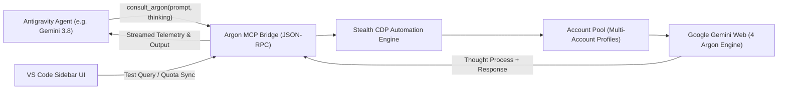

# ⚛️ Antigravity Argon Bridge (4 Argon Model Bridge)

[](LICENSE)
[](https://code.visualstudio.com/)
[](https://antigravity.google)
[](https://gemini.google.com)

**Antigravity Argon Bridge** brings Google's flagship **4 Argon** high-depth reasoning model directly into the **Google Antigravity Agentic IDE** (and any MCP-compatible coding agent) via a seamless VS Code extension and background MCP server.

Pair fast executive agents (like Gemini 3.8 Flash) with Google's deepest multi-pass reasoning engine for complex system architecture, zero-day bug hunting, deep algorithmic proofs, and code analysis—complete with multi-account rotation and real-time quota tracking.

---

## 🌟 Key Features

* **🧠 Native 4 Argon Engine Consultation**:
  Interact directly with Google 4 Argon using customizable thinking depth (`Low`, `Medium`, `High`, or `Auto`).
* **👥 Multi-Account Pro Rotation**:
  Connect multiple Google Pro / Gemini Advanced accounts. When one account hits a rolling rate limit or cooldown, the bridge automatically rotates to the next available account.
* **🛡️ Stealth CDP Browser Automation**:
  Powered by Playwright and CDP-level evasions (`navigator.webdriver` scrubbing, authentic viewport geometry, and persistent user-data profiles) that safely bypass anti-bot challenges and preserve Google carrier SSO/2FA sessions.
* **📊 Quantum Sync & Live Quota Dashboard**:
  View real-time daily turns, estimated token usage, and live Google Pro rolling reset timers in a sleek, glassmorphic VS Code sidebar.
* **🧵 Workspace-Isolated Thread Persistence**:
  Maintains continuous conversation memory per workspace or project without cross-contaminating chats across accounts.
* **🔌 Seamless Dual Integration**:
  Installs as both an interactive **VS Code sidebar extension** and an **MCP Server** (`consult_argon`, `get_argon_usage`, `reset_argon_thread`) for agentic tools.

---

## 🏗️ Architecture



---

## 🚀 Quick Start

### Prerequisites
* [VS Code](https://code.visualstudio.com/) or Antigravity IDE
* [Node.js](https://nodejs.org/) v18+
* At least one Google account with Gemini Pro / Advanced access

### Installation

1. **Clone the repository**:
   ```bash
   git clone https://github.com/AdhirajPersonal/antigravity-argon-bridge.git
   cd antigravity-argon-bridge
   ```

2. **Install dependencies & build**:
   ```bash
   npm install
   npm run build
   ```

3. **Package & install into VS Code**:
   ```bash
   npx @vscode/vsce package --no-dependencies
   code --install-extension agy-argon-extension-1.0.0.vsix --force
   ```

4. **Connect Your Google Account**:
   * Open the **Argon Bridge** tab in the VS Code Activity Bar.
   * Click **+ Add Google Pro Account**.
   * Sign in through the interactive browser window (2FA and passkeys supported).
   * Once logged in, the window closes and your account is ready!

---

## 🛠️ MCP Tool Usage

Once installed, the bridge exposes three native MCP tools to your coding agents:

### 1. `consult_argon`
Consult Google 4 Argon for high-complexity coding tasks:
```json
{
  "prompt": "Prove the amortized complexity of this cache eviction algorithm...",
  "thinking_level": "high",
  "fresh_conversation": false
}
```

### 2. `get_argon_usage`
Check live quota and account pool availability:
```json
{}
```

### 3. `reset_argon_thread`
Start a clean slate for the current workspace thread:
```json
{
  "session_id": "current-project"
}
```

---

## 🔒 Security & Privacy

* **Zero Cloud Storage**: All cookies, session tokens, and usage metrics are saved locally in `~/.gemini/argon-extension/`. No credentials ever leave your machine.
* **Isolated Profiles**: Each connected Google account runs in its own sandboxed browser profile directory to prevent session leakage.

---

## 🤝 Contributing

Contributions, bug reports, and suggestions are welcome!
Feel free to open an issue or submit a pull request.

---

## 📄 License

This project is licensed under the [MIT License](LICENSE).
