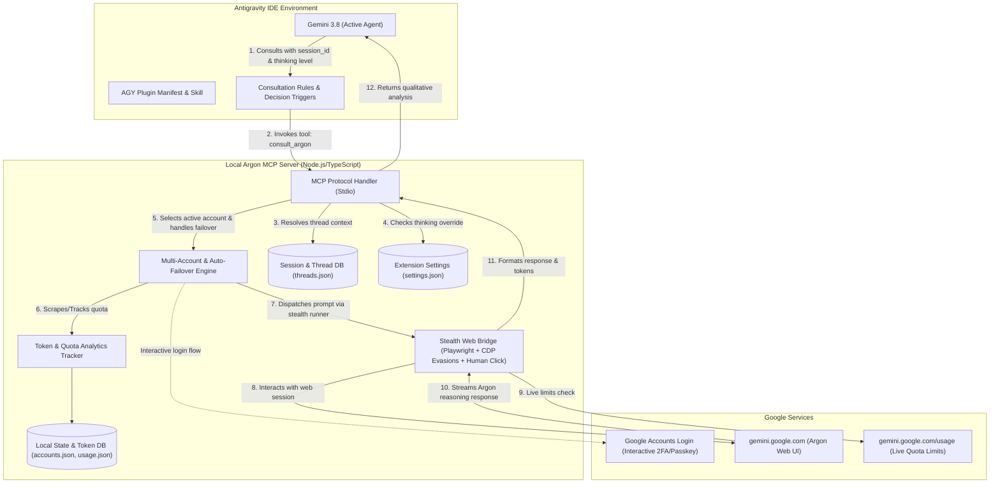

# AGY Argon Extension & MCP Bridge: Architecture & Implementation Plan

An Antigravity (AGY) plugin and Model Context Protocol (MCP) server that connects the IDE's native model (Gemini 3.8) to the web-based **Argon** reasoning model via authenticated user sessions (including promotional/carrier-bundled Gemini Pro accounts like Jio offers).

---

## 1. Executive Summary & Problem Context

- **The Problem**: Google has provided promotional Gemini Advanced/Pro access (e.g., through telecom partners like Jio, device bundles, or introductory offers). Users with these accounts have full access to Google's flagship reasoning model (**Argon**) on the web interface (`gemini.google.com`), but are restricted in IDE environments (Antigravity IDE) to standard tiers or Gemini 3.8 Flash.
- **The Solution**: An Antigravity Plugin combined with a local, multi-account MCP server that acts as an "Oracle Bridge":
  1. The user logs into their Google account(s) via an isolated, secure local browser profile.
  2. The MCP server interfaces with the authenticated `gemini.google.com` session running Argon with stealth anti-detection hardening.
  3. The local Antigravity model (Gemini 3.8) is equipped with custom tools (`consult_argon`, `reset_argon_thread`, `set_argon_settings`) and an automated skill instructing it to consult Argon for complex system design, deep reasoning, and qualitative code analysis.
  4. Multi-account management automatically rotates across registered Pro accounts upon reaching rate limits, and persists conversation thread memory across multi-day IDE sessions.

---

## 2. System Architecture

---

## 3. Core Component Specifications

### 3.1. Antigravity Customization Bundle (`.agents/plugins/agy-argon`)
The extension integrates natively with Antigravity's customization discovery system:

- **`plugin.json`**: Plugin metadata declaration.
- **`mcp_config.json`**: Stdio transport linking Antigravity directly to the local bridge process.
- **`skills/argon-oracle/SKILL.md`**: Instruction manual that teaches Gemini 3.8:
  - When and how to consult Argon.
  - Passing `session_id` to maintain project memory across days.
  - Dynamically choosing thinking depth (`low`, `medium`, `high`).
  - Handling `[ARGON QUOTA EXHAUSTED]` gracefully by falling back to native reasoning without failing tasks.
- **`rules/argon-usage-rules.md`**: Behavioral constraints to avoid wasting Argon web quota on trivial tasks.

### 3.2. Local MCP Server Tools (`@modelcontextprotocol/sdk`)

| Tool Name | Parameters | Description |
| :--- | :--- | :--- |
| `consult_argon` | `prompt` (string), `context` (string, opt), `thinking_level` ("low" \| "medium" \| "high"), `continue_thread` (boolean), `session_id` (string) | Dispatches query to Argon with project thread persistence and auto-failover across accounts. |
| `reset_argon_thread` | `session_id` (string, opt) | Clears conversation memory for a session to start fresh. |
| `set_argon_settings` | `forced_thinking_level` ("auto" \| "low" \| "medium" \| "high") | Configures whether the agent picks thinking depth dynamically or enforces a user hard limit. |
| `get_argon_usage` | None | Scrapes live limits from `gemini.google.com/usage` plus local token metrics and settings. |
| `argon_list_accounts` | None | Lists all saved Google accounts with active status and cooldown expiration timestamps. |
| `switch_argon_account` | `account_id` (string) | Manually switches the active Google account. |
| `argon_login` | `alias` (string, opt) | Launches interactive browser window for adding an account. |
| `argon_logout` | `account_id` (string) | Clears session cookies and removes an account profile. |

### 3.3. Multi-Day Persistent Project Context (`ThreadStore`)
- Stores mappings in `~/.gemini/argon-extension/threads.json`:
  `{ [sessionId]: { threadUrl, accountId, lastUsedAt } }`
- When a user resumes an Antigravity IDE chat days later, supplying `session_id` resumes the exact same conversation URL on `gemini.google.com`, ensuring Argon has complete memory of previous discussions.

### 3.4. Multi-Account Failover & Quota Exhaustion
- **Auto-Rotation**: If Account A hits a temporary hourly/daily limit ("You've reached your limit with this model"), the bridge automatically flags Account A with a cooldown, switches to Account B, and retries seamlessly.
- **Agent Actionable Warning**: If all accounts reach quota, the bridge returns `[ALL_ACCOUNTS_EXHAUSTED]` with the earliest reset time, instructing the agent to fall back to its native reasoning (Gemini 3.8).

### 3.5. Anti-Detection & Account Safety Hardening
- **`navigator.webdriver` Cloaking**: Strips automation flags so Google sees `undefined`.
- **Chrome Runtime & Permissions Spoofing**: Injects standard `window.chrome`, notification permissions query handlers, and realistic plugins.
- **Humanized Interaction (`humanClick`)**: Emulates natural mouse trajectory and randomized timing jitter before clicks.
- **InputEvent Emulation**: Dispatches standard `InputEvent` paste commands instead of raw innerText mutation to safely activate Angular/Lit web bindings.
- **Isolated User Profiles**: Stored locally in `~/.gemini/argon-extension/profiles/<id>` with zero credential capture.

### 3.6. Terminal Polish & ANSI Formatter
- Markdown rendering in CLI: colored headers, code blocks with borders, styled bullet points.
- Real-time heartbeat timer: `Argon is reasoning & thinking... (9s elapsed)`.
- Telemetry cards displaying prompt/completion tokens, active account, and thread URL.
